<div align="center">
  
  <h3>Rapfi</h3>
  A free and powerful Gomoku/Renju engine.
  <br>
  <br>

  [Report bug](https://github.com/dhbloo/rapfi/issues/new)
  ·
  [Open a discussion](https://github.com/dhbloo/rapfi/discussions/new)
  ·
  [Discord](https://discord.gg/7kEpFCGdb5)
  ·
  [Gomocalc](https://gomocalc.com)
  <br>


</div>


> **About this copy.** This folder is a vendored copy of the [Rapfi](https://github.com/dhbloo/rapfi) engine, used by the
> game in the repository root. It is built to WebAssembly by `npm run build:engine` (see the [root README](../README.md)).
> Local changes relative to upstream: `search/searchoutput.h` gains a missing `#include <vector>` (required by Emscripten's libc++),
> and the network weights are the `networks/` submodule (`NETWORKS_DIR` in `CMakeLists.txt`). Paths below are relative to the repository root.

## Overview

Rapfi is a free and powerful Gomoku/Renju (Five in a row) playing engine that analyzes Gomoku/Renju positions and computes the optimal moves. Rapfi engine uses advanced alpha-beta search algorithm with classical and NNUE (Efficiently Updateable Neural Network) evaluation, which achieves more precise evaluation with a significantly larger computation that benefits from the x86-64 vector instructions (such as SSE or AVX).

The engine itself does not contain a graphics user interface (GUI). In order to use it comfortably, you may need a compatible GUI to display the game positions and analysis results and make it easy to input moves. Compatible Gomoku/Renju GUIs include [piskvork](https://github.com/wind23/piskvork_renju), [qpiskvork](https://github.com/Joker2770/qpiskvork) and [Yixinboard](https://github.com/dhbloo/Yixin-Board). Yixinboard is mostly recommended at this moment as it supports the full analysis and database functionality.

You can download a pre-built package of the Rapfi engine and the Yixinboard GUI in the latest [release](https://github.com/dhbloo/rapfi/releases/latest).


## Usage

To use Rapfi engine, first acquire the engine executable either by getting it from Github releases or compiling it yourself. After that, acquire the preset config file, as well as both classical and NNUE evaluation weights from [the network repo](https://github.com/dhbloo/rapfi-networks). Place all weight files and config file in the directory containing the Rapfi engine executable, then Rapfi will automatically find and load required files.

### Piskvork Protocol

When using the Rapfi engine, a user interface program or a match manager program communicates with the engine by sending commands and receiving results via a process pipe. The [Piskvork protocol](https://plastovicka.github.io/protocl2en.htm) describes a standard text-based protocol used to communicates with a Gomoku/Renju engine, which is the default protocol that Rapfi uses when started with no extra commands. Besides the basic protocol, Rapfi also supports the extra commands from the [Yixin-Board extension](https://github.com/accreator/Yixin-protocol/blob/master/protocol.pdf). In addition, Rapfi supports some custom command extensions which are listed in the [documentation](https://github.com/dhbloo/rapfi/wiki/Protocol).

For more information on the Piskvork protocol, please see the [wiki](https://github.com/dhbloo/rapfi/wiki/Protocol).


## Build from source

You can build Rapfi engine from source in an environment with [CMake](https://cmake.org/) installed. Rapfi can be compiled with common compilers with C++17 supports such as msvc, gcc and clang. With cmake and compiler installed and available from shell, Rapfi can be compiled with existing presets:

```bash
cd engine
cmake --preset x64-clang-Native
cmake --build build/x64-clang-Native
```

The above preset builds Rapfi with multi-threading support and native instruction sets targeting x86-64(amd64) platforms. To build it for running on other CPUs with different capabilities, other presets can be chosen accordingly. You can list all available presets with the following command:

```bash
cd engine
cmake --list-presets
```

You can also specify exact combination for instruction supports and other features through CMake options. To see description for all the CMake compile options, please refer to `CMakeLists.txt`. For example, to build Rapfi with only SSE and AVX2 support, use the following command:

```bash
mkdir -p engine/build/x64-clang-AVX2 && cd engine/build/x64-clang-AVX2
cmake ../.. -DCMAKE_C_COMPILER=clang -DCMAKE_CXX_COMPILER=clang++ -DCMAKE_BUILD_TYPE=Release -DUSE_SSE=ON -DUSE_AVX2=ON -DUSE_AVX512=OFF -DUSE_BMI2=OFF -DUSE_VNNI=OFF
cmake --build .
```

To build Rapfi for the ARM64 platform with NEON support, use the following command:

```bash
mkdir -p engine/build/arm64-clang-NEON && cd engine/build/arm64-clang-NEON
cmake ../.. -DCMAKE_C_COMPILER=clang -DCMAKE_CXX_COMPILER=clang++ -DCMAKE_BUILD_TYPE=Release -DUSE_NEON=ON -DUSE_NEON_DOTPROD=OFF
cmake --build .
```

It is recommended to use the Clang compiler, which is tested to provide the best speed across different compilers. When compiling for Windows, consider using one of **LLVM/Clang for Windows** / **Clang-CL for Visual Studio** / **MinGW-w64-Clang**, which compiles the engine binary with significantly higher speed than the builtin MSVC compiler in Visual Studio.

### Build for WebAssembly

To build Rapfi for WebAssembly, you need to have the [Emscripten SDK](https://emscripten.org/docs/getting_started/downloads.html) installed. After that, activate the Emscripten environment, and use the following commands to build Rapfi:

```bash
# Make sure you have activated the Emscripten environment
mkdir -p engine/build/wasm-multi-simd128 && cd engine/build/wasm-multi-simd128
emcmake cmake ../.. -DCMAKE_BUILD_TYPE=Release -DNO_COMMAND_MODULES=ON -DUSE_WASM_SIMD=ON -DUSE_WASM_SIMD_RELAXED=OFF
emmake cmake --build .
```

To target browsers with different WebAssembly SIMD support, you can turn on or turn off the `USE_WASM_SIMD` and `USE_WASM_SIMD_RELAXED` options. Additionally, you can turn on or turn off the `NO_MULTI_THREADING` option to disable multi-threading support in the WebAssembly build, which is required for browsers that do not support WebAssembly threads.

## Terms of use

### GNU General Public License version 3

Rapfi is free and distributed under the [**GNU General Public License version 3**](https://github.com/dhbloo/rapfi/blob/master/Copying.txt) (GPL v3). Essentially, this means you are free to do almost exactly what you want with the program, including distributing it among your friends, making it available for download from your website, selling it (either by itself or as part of some bigger software package), or using it as the starting point for a software project of your own.

The only real limitation is that whenever you distribute Rapfi in some way, you MUST always include the license and the full source code (or a pointer to where the source code can be found) to generate the exact binary you are distributing. If you make any changes to the source code, these changes must also be made available under GPL v3.
